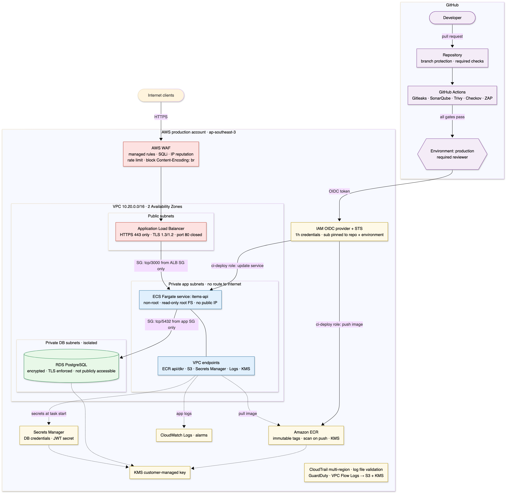

# Architecture and Security Design



The diagram is generated from [`architecture-diagram.mmd`](architecture-diagram.mmd) (Mermaid). This is the **target architecture**. The Terraform in [`terraform/`](../terraform/) implements the minimal subset that Task 3 asks for (see section 8).

## 1. Overview

The `items-api` container runs on **ECS Fargate** in private subnets of a dedicated production AWS account in `ap-southeast-3` (Jakarta), across two Availability Zones:
- The only internet-facing component is an **Application Load Balancer** protected by **AWS WAF**.
- Data lives in **RDS PostgreSQL** in isolated subnets.
- Images come from **ECR** and secrets from **Secrets Manager**, all encrypted with a **KMS** customer-managed key.
- **CloudTrail**, **CloudWatch** and **GuardDuty** provide audit and detection.

Deployments happen only through GitHub Actions, using **OIDC** (short-lived credentials, no stored keys), after every security gate passes and a human approves the `production` environment.

## 2. Request flow

1. The client connects over **HTTPS (443)**.
2. **AWS WAF** filters the request:
   - managed rules: core, known bad inputs, SQL injection, IP reputation
   - a per-IP rate limit
   - a rule blocking `Content-Encoding: br`, a virtual patch for CVE-2026-111497
3. The **ALB** (public subnets) terminates TLS 1.2+ and forwards to the tasks on port 3000. Port 80 is never opened.
4. The **Fargate task** (private subnet) only accepts traffic from the ALB security group. It validates the JWT and the input.
5. The app queries **RDS** over TLS. The DB security group only accepts 5432 from the app security group.

## 3. Public vs. private resources

| Resource | Exposure |
|---|---|
| WAF + ALB | **Public**, HTTPS only: the single, inspected entry point |
| ECS tasks | **Private**: no public IP, no route to the internet |
| RDS | **Private**: isolated subnets, `publicly_accessible = false`, reachable from the app SG only |
| VPC endpoints (ECR, S3, Secrets Manager, Logs, KMS) | **Private**: AWS API calls never leave the AWS network, so tasks need no internet access |
| ECR, Secrets Manager, KMS, CloudWatch, Terraform state | Private AWS APIs, accessible only through IAM roles |

## 4. Secrets without hardcoding

| Secret | Stored in | Created / rotated by |
|---|---|---|
| DB master credentials | Secrets Manager (KMS) | RDS itself (`manage_master_user_password = true`): generated and rotated automatically, never in Terraform state |
| `JWT_SECRET` | Secrets Manager (KMS) | Terraform `ephemeral` resource + write-only `secret_string_wo`: never in Terraform state |

The task definition references each secret **by ARN**. At task start, the ECS agent uses the **task execution role** to fetch them through the VPC endpoint and injects them as environment variables. The app reads `process.env` and refuses to start if any are missing. No secret is in the image, Git, CI variables or logs.

## 5. IAM roles

| Role | Assumed by | Can do |
|---|---|---|
| `items-api-prod-gha-deploy` | GitHub OIDC, only `repo:Azhar275/indico-submission:environment:production` | Push to **one** ECR repo, register task definitions, update **one** ECS service, pass **only** the two task roles to ECS |
| `items-api-prod-task-execution` | ECS agent | Pull from the one ECR repo, write to the one log group, read the two secrets, `kms:Decrypt` only via Secrets Manager |
| `items-api-prod-task` | Application code | **Nothing.** The app makes no AWS calls, so a compromised container gets no useful credentials |

The Terraform itself is applied by a separate, admin-only role from a bootstrap stack (out of scope).

### Example critical control: GitHub OIDC deploy role

This replaces *"production deployment credentials stored in CI/CD variables"*. There are no access keys: GitHub issues a signed token per job, and STS exchanges it for **1-hour** credentials, but only for this repo's `production` environment, which requires a human approval. It's implemented in [`terraform/main.tf`](../terraform/main.tf) (`aws_iam_role.gha_deploy`).

Trust policy:

```json
{
  "Version": "2012-10-17",
  "Statement": [{
    "Effect": "Allow",
    "Principal": { "Federated": "arn:aws:iam::111122223333:oidc-provider/token.actions.githubusercontent.com" },
    "Action": "sts:AssumeRoleWithWebIdentity",
    "Condition": { "StringEquals": {
      "token.actions.githubusercontent.com:aud": "sts.amazonaws.com",
      "token.actions.githubusercontent.com:sub": "repo:Azhar275/indico-submission:environment:production"
    }}
  }]
}
```

Permissions policy:

```json
{
  "Version": "2012-10-17",
  "Statement": [
    { "Sid": "EcrAuth", "Effect": "Allow", "Action": "ecr:GetAuthorizationToken", "Resource": "*" },
    { "Sid": "EcrPushOneRepository", "Effect": "Allow",
      "Action": ["ecr:BatchCheckLayerAvailability", "ecr:InitiateLayerUpload", "ecr:UploadLayerPart",
                 "ecr:CompleteLayerUpload", "ecr:PutImage", "ecr:BatchGetImage", "ecr:DescribeImages"],
      "Resource": "arn:aws:ecr:ap-southeast-3:111122223333:repository/items-api" },
    { "Sid": "TaskDefinitionsNoResourceLevelSupport", "Effect": "Allow",
      "Action": ["ecs:RegisterTaskDefinition", "ecs:DescribeTaskDefinition"], "Resource": "*" },
    { "Sid": "UpdateOneService", "Effect": "Allow",
      "Action": ["ecs:UpdateService", "ecs:DescribeServices"],
      "Resource": "arn:aws:ecs:ap-southeast-3:111122223333:service/items-api-prod/api" },
    { "Sid": "PassOnlyTheTaskRoles", "Effect": "Allow", "Action": "iam:PassRole",
      "Resource": ["arn:aws:iam::111122223333:role/items-api-prod-task-execution",
                   "arn:aws:iam::111122223333:role/items-api-prod-task"],
      "Condition": { "StringEquals": { "iam:PassedToService": "ecs-tasks.amazonaws.com" } } }
  ]
}
```

`ecs:RegisterTaskDefinition` doesn't support resource-level permissions, so it must be `*`. The real guard is `iam:PassRole`: a forged task definition can only use the two pre-approved roles.

## 6. Preventing unauthorized access to production

- **Separate AWS account** for production. Dev and staging can't reach it.
- **Humans:** SSO with MFA, no IAM users or access keys, read-only by default, time-bound break-glass for changes.
- **Guardrails (SCPs):** deny disabling CloudTrail/GuardDuty, deny creating IAM users or access keys, deny other regions.
- **Machines:** OIDC role pinned to repo **and** `production` environment, 1-hour sessions, least privilege.
- **Change control:** branch protection on `main` (PR, required security checks, no bypass); the `production` environment needs an approver and only deploys from `main`.
- **Network:** only the ALB is public; no SSH or bastion.

## 7. Security risks and mitigations

| # | Risk | Mitigation |
|---|---|---|
| 1 | Over-permissive IAM (`Action: *`) | Per-purpose roles, resource-level ARNs, restricted `iam:PassRole`, SCPs |
| 2 | Secrets committed to Git | Gitleaks blocks the pipeline; secrets only in Secrets Manager; `.env`, `*.tfvars`, `*.tfstate` git-ignored |
| 3 | Long-lived prod credentials in CI | GitHub OIDC with 1-hour credentials; nothing stored in CI |
| 4 | Vulnerable container image | Trivy image gate + Node.js runtime gate, ECR scan on push, immutable tags, deploy by digest, npm removed, non-root |
| 5 | Vulnerable code or dependencies | SonarQube (SAST), Trivy (SCA), ZAP (DAST), WAF as an extra layer |
| 6 | Insecure Terraform (e.g. public DB) | Checkov + Trivy config gates block the change before deployment |
| 7 | Pipeline gates bypassed | Required status checks, deploy depends on every gate, `production` approval, deploy role trusts only that environment |
| 8 | Database exposed or data stolen | Isolated subnets, not public, SG chaining, TLS enforced, KMS encryption, backups, deletion protection |

## 8. What the Terraform implements (Task 3 scope)

| In `terraform/main.tf` | Target design only |
|---|---|
| VPC with private app and DB subnets, security groups, VPC endpoints, KMS, RDS, Secrets Manager, ECR, ECS Fargate service, the three IAM roles above, tags, per-environment variables | ALB + WAF (public entry point), CloudTrail, GuardDuty, VPC flow logs, SCPs and SSO |

The brief asks Task 3 for a *minimal* deployment that demonstrates least privilege, encryption, restricted networking, secret handling, tagging, environment separation and IaC scanning. The target-design items are left out to keep it minimal. Without the ALB, the service isn't reachable from the internet in this Terraform.

## 9. Assumptions

- Deployment is **simulated**: Terraform is validated and scanned, not applied.
- Account IDs (`111122223333`) are placeholders.
- TLS terminates at the ALB, and traffic inside the VPC is protected by security groups.
- Single region; multi-region DR is out of scope.
